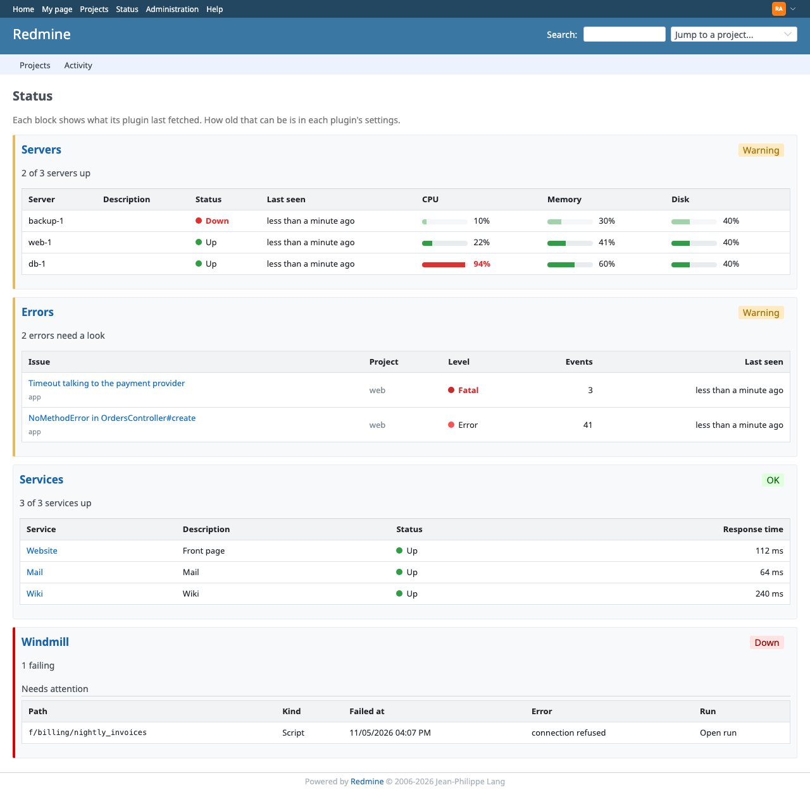
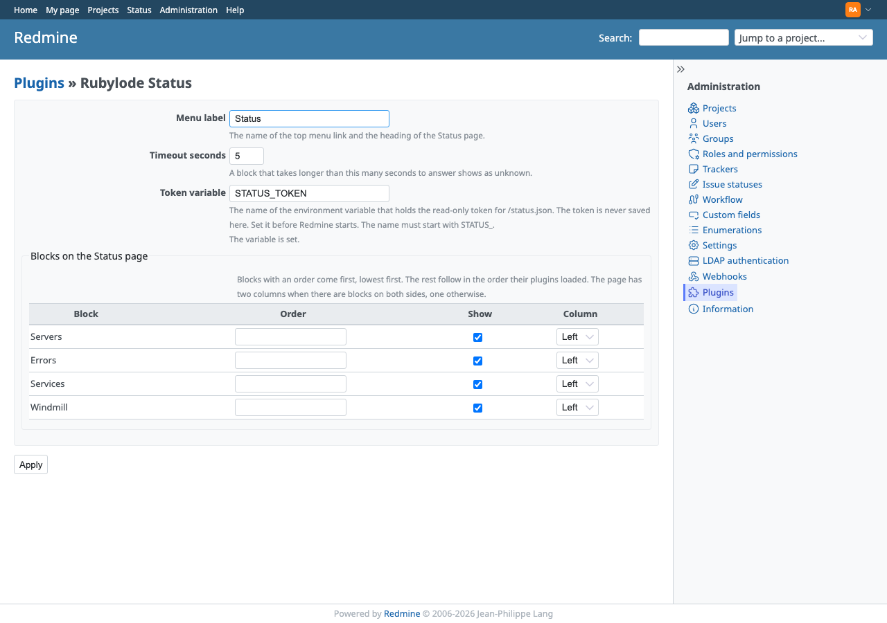
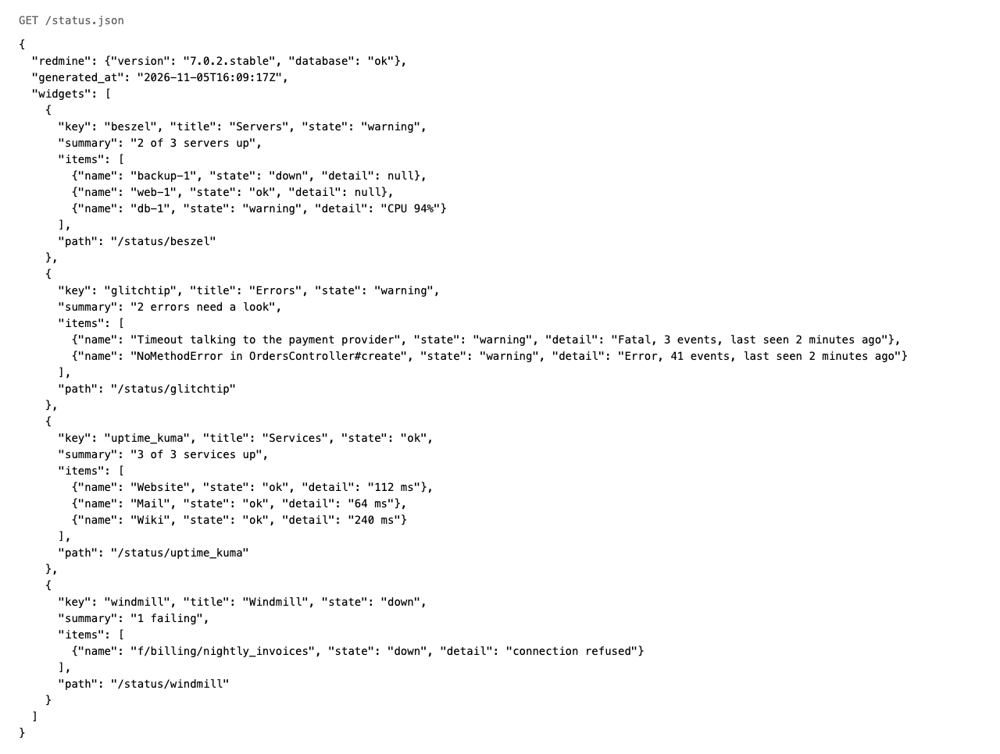

# Rubylode Status for Redmine

[](https://github.com/rubylode/redmine-rubylode-status/actions/workflows/tests.yml)
[](https://github.com/rubylode/redmine-rubylode-status/actions/workflows/security.yml)
[](https://github.com/rubylode/redmine-rubylode-status/blob/main/LICENSE)


One Status page and one top menu link for the status blocks of the other Rubylode plugins, plus `/status.json` for monitors.

Four plugins showed a status in my [Redmine](https://www.redmine.org) (servers, errors, services, Windmill runs), and each
added its own top menu link with its own wording. The menu got crowded. Now each of them registers a block here, and the
Status page draws them all. This plugin draws only what is registered and never reads another plugin's settings. Installed
alone, it shows an empty page that names the plugins that can fill it.



- [Install](#install)
- [Settings](#settings)
- [Where it shows](#where-it-shows)
- [Security](#security)
- [Troubleshooting](#troubleshooting)
- [Tests](#tests)
- [License](#license)

## Install

Redmine 7.0 or newer, on any database Redmine supports. The plugin adds no tables.

1. Put the plugin folder in Redmine's `plugins/` directory, named `redmine_rubylode_status`.

       cd /path/to/redmine/plugins
       git clone https://github.com/rubylode/redmine-rubylode-status.git redmine_rubylode_status

2. Run `bundle exec rake redmine:plugins:migrate RAILS_ENV=production`.
3. If the plugin reads an environment variable, set it where Redmine runs, then restart Redmine.
   This one reads `STATUS_TOKEN`, and only if a monitor should read `/status.json` without a Redmine account
   (see [Security](#security)). Restart Redmine either way, so it loads the plugin.
4. In Administration, Plugins, open the plugin and choose Configure.

Then install the plugins that add a block ([listed below](#plugins-that-add-a-block)). Each registers its block from version 2.0.0.

To remove it, delete the folder and restart.

## Settings

Administration, Plugins, Rubylode Status, Configure.

| Setting | Default | What it does |
|---|---|---|
| Menu label | Status | The name of the top menu link and the heading of the Status page. |
| Timeout seconds | 5 | A block that takes longer than this many seconds to answer shows as unknown. 1 to 60. |
| Token variable | `STATUS_TOKEN` | The name of the environment variable that holds the read-only token for `/status.json`. The token is never saved here. Set it before Redmine starts. The name must start with `STATUS_`. |

Under the token variable the page says whether the variable is set, without showing its value.



The settings page, with the layout of the four blocks and the token variable set.

Blocks on the Status page lists every registered block, with three settings each:

- Order: blocks with a number come first, lowest first. The rest follow in the order their plugins loaded, which is
  alphabetical by folder name.
- Show: uncheck it to leave the block off the page, out of `/status.json`, and out of the reasons to show the menu link.
- Column: Left or Right. The page has two columns when there are blocks on both sides, one otherwise.

Who may see a block is the block's own setting, in its own plugin. The settings page marks the administrators-only ones.

## Where it shows

### The top menu and `/status`

A link in the top menu, named by Menu label, for people who may see at least one block. It opens `/status`, which shows
each block with its title (a link to the plugin's own page), its state (OK, Warning, Down or Unknown), a one-line summary and
its items. A plugin may draw the body of its block itself.

Each block shows what its plugin last fetched. How old that can be is in each plugin's settings.

A visitor who is not signed in is sent to the sign-in page. Someone signed in who may see none of the registered blocks gets
403. With nothing registered, the page says so and lists the plugins below.

### `/status.json`

The same blocks as JSON, for a monitor or a script. It takes a signed-in browser session, a Redmine
[API key](https://www.redmine.org/projects/redmine/wiki/Rest_api#Authentication) (with the REST API turned on in
Administration, Settings, API), or the status token ([Security](#security)).

    curl -H "Authorization: Bearer $STATUS_TOKEN" https://redmine.example.com/status.json

```json
{
  "redmine": { "version": "7.0.2.stable", "database": "ok" },
  "generated_at": "2026-11-04T21:30:00Z",
  "widgets": [
    {
      "key": "beszel",
      "title": "Servers",
      "state": "warning",
      "summary": "1 of 3 servers busy",
      "items": [{ "name": "web-1", "state": "warning", "detail": "CPU 91%" }],
      "path": "/status/beszel"
    }
  ]
}
```

- `redmine.version` is Redmine's version. `redmine.database` is `ok` when the database answers `SELECT 1`, `down` otherwise.
- `generated_at` is when the answer was put together, in UTC.
- `widgets` lists the blocks the caller may see, in page order. `state` is `ok`, `warning`, `down` or `unknown` for a block and
  for each item. `detail` may be `null`. `path` is the block's own page.
- Without a session, a valid API key or the token the answer is 401 with
  `{ "error": "Sign in, or send a Redmine API key or the status token." }`.



The answer for the four blocks of the preview, from stub services.

### Plugins that add a block

| Plugin | The block shows |
|---|---|
| [Rubylode Beszel](https://github.com/rubylode/redmine-rubylode-beszel) | servers from a [Beszel](https://beszel.dev) hub |
| [Rubylode GlitchTip](https://github.com/rubylode/redmine-rubylode-glitchtip) | recent [GlitchTip](https://glitchtip.com) errors |
| [Rubylode Uptime Kuma](https://github.com/rubylode/redmine-rubylode-uptime-kuma) | services from [Uptime Kuma](https://uptime.kuma.pet) |
| [Rubylode Windmill](https://github.com/rubylode/redmine-rubylode-windmill) | failed runs and schedules from [Windmill](https://www.windmill.dev) |

Each works without this plugin too, with its own page and its own top menu link. From 2.0.0, with this one installed, it
drops its menu link and its settings page says where the block went. Writing a plugin that adds a block: [docs/widget-contract.md](docs/widget-contract.md).

## Security

- The status token is optional. Without it `/status.json` takes only a Redmine login or API key.
- The token lives in an environment variable. The setting holds only the variable's name, which must start with `STATUS_`,
  so it cannot point at Redmine's own secrets. The value is never saved, shown on the settings page, or put in the JSON.
- The token is accepted in an `Authorization: Bearer` or an `X-Status-Token` header, never in the address, because addresses
  end up in logs. The comparison runs on SHA-256 hashes of both sides with
  [`OpenSSL.fixed_length_secure_compare`](https://docs.ruby-lang.org/en/master/OpenSSL.html#method-c-fixed_length_secure_compare),
  so it takes the same time whatever is guessed.
- The token opens `/status.json` and nothing else, not even `/status`. It sees the blocks meant for everyone signed in, never
  the administrators-only ones.
- `/status.json` accepts the browser session, which Redmine's own JSON endpoints don't. It only answers GET and changes nothing.
- When a block fails, its error goes to the Redmine log, not to the page or the JSON. Errors can name hosts and addresses.

## Troubleshooting

- No Status link in the top menu: no plugin has registered a block, the blocks are unchecked under Show, or they are for
  administrators only. A sibling plugin older than 2.0.0 doesn't register.
- A block shows "This block could not be loaded": the Redmine log has a line starting
  `Rubylode Status: the <key> block failed`, with the error. The fix is usually in that plugin's settings.
- A block shows "This block did not answer within 5 seconds": its plugin is waiting on the service behind it. Check that
  plugin's timeout, or raise Timeout seconds here.
- `/status.json` answers 401 to a monitor: check that the settings page says the variable is set, that Redmine was restarted
  after setting it, and that the token goes in a header. For an API key, the REST API must be on.

## Tests

    bin/test                                   all unit and integration tests
    bin/test test/integration/status_json_test.rb

They run in a Redmine 7 image with its test gems (`docker/test.Dockerfile`), with stub blocks registered the way the other
plugins do it. They cover the registry, a block that raises or takes too long, the order, columns and visibility, the empty
page, the menu label, the settings form, and `/status.json` with a session, an API key, the token and nothing. CI is set to run them
on Redmine 7.0.2 and 7.0-stable, with Ruby 3.4 and 4.0. The colors on the page have no test.

A throwaway Redmine for a look: `docker compose up -d`, then http://localhost:3017. With no other plugin there the page is
the empty one.

Pull Requests are welcome!

## License

GPL v2 or later, the same as Redmine. See `LICENSE`.

Copyright (C) 2026  Nick Gorbikoff. Each Ruby file carries the same short notice Redmine puts on its own.

No warranty, as the GPL says. I ran the tests on Redmine 7.0.2, and nothing else yet.
